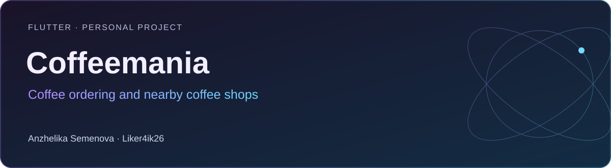

# Coffeemania

**Flutter · Personal project** · Flutter · Dart · Riverpod / Hooks · Dio · SQLite · GetIt / Injectable · Yandex MapKit

Приложение для выбора напитков, работы с корзиной и поиска кофеен рядом — на карте и в списке.

[Портфолио автора](https://portfolio.semenova-anzhelika.online/) · [Профиль GitHub](https://github.com/Liker4ik26) · [Исходники](https://github.com/Liker4ik26/coffeemania/tree/master)

## Как выглядит проект


### Видеодемонстрации

- [Order Placement Example (Light Theme)](https://github.com/user-attachments/assets/881941f9-bb7e-4888-b45f-69d4f74376da)
- [Order Placement Example (Dark Theme)](https://github.com/user-attachments/assets/d7047cd7-cc8e-4851-9346-97c2907d24cf)
- [Product Quantity Selection (Light Theme)](https://github.com/user-attachments/assets/90b5d11c-8498-4158-800f-169f8aa2b007)
- [Clear Cart Option (Light Theme)](https://github.com/user-attachments/assets/8a4df6f7-716d-4485-aeff-698d212a4ea9)

[Все демонстрации проекта](docs/GALLERY.md)

## Что в проекте

- Каталог напитков и категории.
- Добавление товаров в корзину, изменение количества и очистка корзины.
- Геолокация, кофейни на карте Yandex MapKit и отдельный список кофеен.
- Сохранение корзины в SQLite и пользовательских настроек в SharedPreferences.
- Светлая и тёмная темы, локализация и обработка сетевых состояний.

## Технологии

| Направление | Реализация |
| :--- | :--- |
| Стек | Flutter · Dart · Riverpod / Hooks · Dio · SQLite · GetIt / Injectable · Yandex MapKit |
| Формат | Flutter · Personal project |
| Окружение | Dart >=3.3.4 <4.0.0; совместимый Flutter SDK |

## Где смотреть код

- lib/src/features/ — каталог, корзина, карта и список кофеен
- lib/src/database/ — локальная база и репозиторий корзины
- packages/coffee_repository/ — отдельный пакет доступа к данным
- lib/di/ — регистрация зависимостей

## Как запустить

Требования: Dart >=3.3.4 <4.0.0; совместимый Flutter SDK.

```bash
git clone --branch master https://github.com/Liker4ik26/coffeemania.git
cd coffeemania
flutter pub get
```

Создайте локальный .env с BASE_URL вашего API. Для карты требуется собственный ключ Yandex MapKit и разрешения геолокации. При необходимости обновите сгенерированные файлы командой dart run build_runner build --delete-conflicting-outputs.

```bash
flutter run
```

## English overview

**Coffeemania — Coffee ordering and nearby coffee shops.**

Flutter · Personal project. Stack: Flutter · Dart · Riverpod / Hooks · Dio · SQLite · GetIt / Injectable · Yandex MapKit. [Explore my professional portfolio](https://portfolio.semenova-anzhelika.online/).

---

**Автор — Анжелика Семёнова · [Liker4ik26](https://github.com/Liker4ik26)**

[Сайт](https://portfolio.semenova-anzhelika.online/) · [Telegram](https://t.me/Liker4ik50) · [Почта](mailto:pr110oat18@gmail.com)
